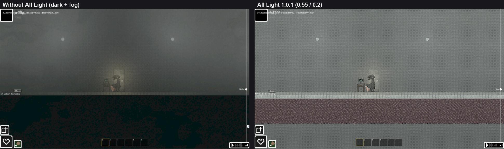

# All Light — 全亮 / 移除视野惩罚

《Casualties: Unknown / 未知伤亡》BepInEx 5 插件：

- **所有难度、所有层数**强制地图全亮，不受 `ambientlight`（环境光）难度设置影响；
- 移除生物群系雾气、视线遮挡；
- 移除眼伤、失明、失血、疼痛、缺氧、饥渴、精神崩溃等屏幕视野惩罚；
- `F7` 游戏内随时开关，方便对比。

- 版本：1.0.1
- 适用：Casualties: Unknown（Unity Mono / BepInEx 5.4.x x64）
- 快捷键：`F7`
- GUID：`com.lead.alllight`



*左：强制黑暗 + 雾气 + 视线遮挡；右：All Light 全亮。*

---

## 功能

### 光照

| 功能 | 说明 |
| --- | --- |
| 强制环境光 | 每帧把 `WorldGeneration.ambientLight.intensity` 设为配置值（默认 0.55，原版 bright 仅 0.4） |
| 关闭雾气 | `WorldGeneration.SetFog(0)`，移除各层雾/黑暗叠加 |
| 关闭视线遮挡 | 拦截 `PlayerCamera.HandleLineOfSight` 并清空 `VisionMask`，整张地图直接可见 |

### 视野惩罚

通过 `PlayerCamera.HandleScreenShaders` 的 Postfix 覆盖以下屏幕效果：

- 眼伤 / 双眼失明 / 眼罩：`_EyeDamage = 0`，模糊叠加 `_BlurIntensity = 0`；
- 脑损伤：`_BrainDamage = 0`；
- 失血：`_Bloodloss = 0`；
- 疼痛：`_Pain = 0`；
- 低氧：`_LowOxyAmt = 0`；
- 饥饿 / 口渴：`_HungerIntensity = 0`；
- 疾病 / 呕吐：`_SicknessAmount = 0`；
- 精神崩溃 / 幻觉：`_Insanity = 0`、`_Distort = 0`；
- 辐射：`_RadAmount = 0`；
- 冷 / 热：`_FrostAmount = 0`、`_OverheatAmount = 0`；
- 脏污：`_Dirtyness = 0`；
- 昏迷 / 雾气：`_Consciousness = 1`；
- 画面亮度：`_Brightness = 配置值`（默认 0.2，避免过曝和发灰）。

> 只改视觉，不修改身体属性、不治疗、不改变游戏难度参数；关掉插件后一切恢复。

---

## 快捷键

| 按键 | 作用 |
| --- | --- |
| `F7` | 开启 / 关闭 All Light |

---

## 配置

配置文件：`BepInEx\config\com.lead.alllight.cfg`

| 配置项 | 默认值 | 说明 |
| --- | --- | --- |
| `Enabled` | `true` | 总开关 |
| `Toggle Key` | `F7` | 游戏内切换键 |
| `Ambient Light Intensity` | `0.55` | 强制环境光强度（0–2） |
| `Disable Fog` | `true` | 移除雾气 |
| `Disable Line Of Sight` | `true` | 关闭视线遮挡，整图可见 |
| `Remove Vision Penalties` | `true` | 移除所有屏幕视野惩罚 |
| `Screen Brightness` | `0.2` | 强制画面亮度（0–1） |

如果还是觉得亮：`Ambient Light Intensity` 0.55 → 0.45，`Screen Brightness` 0.2 → 0.1。
如果觉得暗：环境光升到 0.65–0.75，画面亮度升到 0.3。

1.0.1 已把默认值从 0.8 / 0.5 降下来，画面不再发白，同时保留全图可见。

---

## 安装

1. 安装 BepInEx 5.4.x（x64, Mono）。
2. 把 `AllLight.dll` 放到：
   ```
   ...\Casualties Unknown\BepInEx\plugins\AllLight\AllLight.dll
   ```
3. 启动游戏，日志出现 `All Light v1.0.0 loaded` 即成功。
4. 进游戏按 `F7` 开关。

---

## 注意事项

- 这是**视觉插件**，不会让玩家无敌；掉血、断肢等机制仍然生效，只是屏幕不再被眼伤/失血/疼痛等效果遮挡。
- “关闭视线遮挡”会让整张地图可见，可能降低探索感；可单独把 `Disable Line Of Sight` 设为 `false`。
- 联机时只影响本地画面，不修改世界数据；但全图可见属于客户端优势，是否使用请自行判断。
- 与 Highlight、Slot Hotkeys、Cheat Menu 等客户端插件兼容。
- 卸载：删除 `BepInEx\plugins\AllLight\` 和 `com.lead.alllight.cfg`。

---

## 版本

- 1.0.0 — 首个版本：强制全亮、关雾、关视线遮挡、移除全部屏幕视野惩罚，F7 开关。
- 1.0.1 — 降低默认亮度：环境光 0.55、画面亮度 0.2，缓解发白/刺眼。
