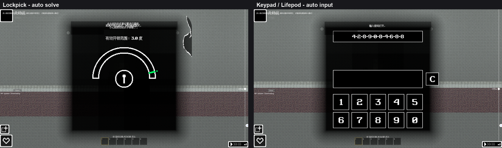

# Auto Unlock — 自动开锁 / 自动密码

《Casualties: Unknown / 未知伤亡》BepInEx 5 插件：

- 进入**开锁小游戏**后自动完成开锁；
- 进入**空投仓 / 密码盘数字输入界面**后自动输入正确密码；

- 版本：1.0.0
- 适用：Casualties: Unknown（Unity Mono / BepInEx 5.4.x x64）
- GUID：`com.lead.autounlock`



*左：开锁界面；右：空投仓/密码盘界面。*

## 配置

配置文件：`BepInEx\config\com.lead.autounlock.cfg`

| 配置项 | 默认值 | 说明 |
| --- | --- | --- |
| `Enabled` | `true` | 总开关 |
| `Solve Delay` | `0.6` | 界面出现后等待多少秒自动完成（0–5） |
| `Auto Lockpick` | `true` | 自动完成开锁 |
| `Auto Keypad` | `true` | 自动完成空投仓/密码盘 |
| `Verbose Log` | `false` | 记录自动完成日志 |

> 不想自动开锁、只想自动输密码：把 `Auto Lockpick` 设为 `false`，反之亦然。

---

## 安装

1. 安装 BepInEx 5.4.x（x64, Mono）。
2. 把 `AutoUnlock.dll` 放到：
   ```
   ...\Casualties Unknown\BepInEx\plugins\AutoUnlock\AutoUnlock.dll
   ```
3. 启动游戏，日志出现 `Auto Unlock v1.0.0 loaded` 即成功。
4. 进入开锁或密码界面，等待 0.6 秒自动完成。

---

## 注意事项

- 自动完成沿用游戏自身的成功路径（目标 `health = 0` + `EndMinigame()`），不会额外修改物品或存档。
- 建议单人使用；联机时自动完成可能与其他玩家不同步。
- 如果某次界面没有自动完成，检查 `Enabled`、对应 `Auto Lockpick` / `Auto Keypad` 是否为 `true`，以及目标是否已被其他方式打开。
- 卸载：删除 `BepInEx\plugins\AutoUnlock\` 和 `com.lead.autounlock.cfg`。

---

## 实测

- 开锁界面：启动后约 0.6 秒自动结束，`currentMinigame` 变为 `null`；
- 密码界面：同样自动结束，无需输入；
- 中断测试：开锁界面出现后 0.15 秒按 `Esc`，界面关闭，之后没有延迟完成、没有异常；
- 目标对象缺失测试：捕获异常并强制结束小游戏，界面不会卡住。

---

## 版本

- 1.0.0 — 首个版本：自动开锁、自动空投仓/密码盘输入，支持延迟与中断取消。
