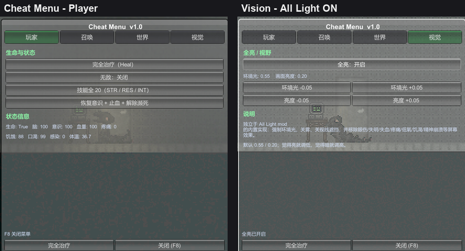

# Cheat Menu — 常用作弊菜单

《Casualties: Unknown / 未知伤亡》BepInEx 5 插件：

- 游戏内按 `F8` 打开/关闭作弊菜单；
- 所有功能都是**按钮点击**执行，不需要记指令；
- 四个分页：玩家、召唤、世界、视觉；
- 纯客户端，只修改当前存档/当前世界，不写入 mod 文件。

- 版本：1.1.0
- 适用：Casualties: Unknown（Unity Mono / BepInEx 5.4.x x64）
- 快捷键：`F8`
- GUID：`com.lead.cheatmenu`



*玩家分页，以及新增的“视觉 → 全亮”分页。*

---

## 功能

### 玩家

| 按钮 | 效果 |
| --- | --- |
| 完全治疗（Heal） | 调用游戏 `Body.Heal()`：回满生命、脑、血、氧、意识、饥饿、口渴、体温，移除感染、出血、骨折、断肢等 |
| 无敌：开 / 关 | 开启后每 0.5 秒自动治疗，并拦截死亡结算（不会进入死亡画面） |
| 技能全 20 | STR / RES / INT 全部设为 20，并重置经验边界 |
| 恢复意识 + 止血 + 解除濒死 | 单独把意识、脑健康拉满并治疗 |

状态信息会实时显示生命、脑、意识、血量、疼痛、饥饿、口渴、感染、体温。

### 召唤

| 分类 | 内容 |
| --- | --- |
| 常用物品 | medkit、bandage、morphine、antibiotics、waterbottle、canteen、pistol、9mmround、smallmagazine、lockpickingkit、primitivediggingtool、flashlight |
| 敌人 | shadecrawler、thornbackelder、guard、wallbiter、overgrowntick、bloodsuckerden |
| 陷阱 | beartrap、landmine、spikestabber |

- 物品生成在玩家身边 1.5 米；
- 敌人生成在玩家前方约 4 米；
- 生成物直接使用游戏原版 prefab，和正常刷出的物品/敌人一致。

### 视觉（全亮）

内置了一套独立于 **All Light** mod 的全亮实现，即使没装 All Light 也能用：

| 按钮 | 效果 |
| --- | --- |
| 全亮：开 / 关 | 强制环境光、关闭雾气、关闭视线遮挡，并移除眼伤/失明/失血/疼痛/低氧/饥渴/精神崩溃等屏幕效果 |
| 环境光 -0.05 / +0.05 | 调整强制环境光（默认 0.55） |
| 亮度 -0.05 / +0.05 | 调整强制画面亮度（默认 0.20） |

> 两个 mod 不会合并：Cheat Menu 里是内置实现，All Light 仍是独立插件；同时安装也不会冲突，各自开关互不影响。

### 世界

| 按钮 | 效果 |
| --- | --- |
| 传送到记录的鼠标位置 | 打开菜单时记录鼠标对应的世界坐标，点击后把玩家和相机传送过去 |
| 传送到世界原点 (0,0) | 传送到地图坐标 0,0 |
| 跳过本层（进入下一层） | 调用游戏自身的 `WorldGeneration.RegenerateWorld()`，重新生成世界并进入下一层 |
| 清除场上所有敌人 / NPC | 把除玩家外的所有 `Body` 清空（包括 NPC，慎用） |

> 传送坐标是**打开菜单那一刻**鼠标指向的位置；菜单挡住画面后不会重新取点。想换传送点，关闭菜单、把鼠标移到目标位置，再按 F8。

---

## 快捷键

| 按键 | 作用 |
| --- | --- |
| `F8` | 打开 / 关闭作弊菜单 |

菜单打开时：

- 玩家停止移动（`forceNoMovement`）；
- 鼠标解锁并显示；
- 关闭菜单后恢复原来的鼠标/移动状态。

---

## 配置

配置文件：`BepInEx\config\com.lead.cheatmenu.cfg`

| 配置项 | 默认值 | 说明 |
| --- | --- | --- |
| `Toggle Key` | `F8` | 打开/关闭菜单 |
| `Start With God Mode` | `false` | 加载时是否默认开启无敌 |
| `Menu Scale` | `1.0` | 菜单缩放（0.7–1.6） |
| `Log Actions` | `true` | 把使用的作弊写入 BepInEx 日志 |

### 全亮

| 配置项 | 默认值 | 说明 |
| --- | --- | --- |
| `Ambient Light Intensity` | `0.55` | 内置全亮的环境光强度 |
| `Screen Brightness` | `0.2` | 内置全亮的画面亮度 |

---

## 安装

1. 安装 BepInEx 5.4.x（x64, Mono）。
2. 把 `CheatMenu.dll` 放到：
   ```
   ...\Casualties Unknown\BepInEx\plugins\CheatMenu\CheatMenu.dll
   ```
3. 启动游戏，日志出现 `Cheat Menu v1.0.0 loaded` 即成功。
4. 进游戏按 `F8` 打开菜单。

---

## 注意事项

- **建议只在单人/沙盒使用**；联机使用召唤、跳关、清场可能造成不同步或被房主踢出。
- “清除敌人 / NPC”会杀死除玩家外的所有 `Body`，包括商人之类的 NPC。
- “跳过本层”使用游戏原版换层逻辑，会重新生成世界，可能需要几秒；教程/沙盒模式下可能回到训练课程选择。
- 无敌通过拦截死亡结算 + 持续治疗实现，不等同于原版无敌字段；极端连续伤害下仍可能短暂倒地，但不会进入死亡画面。
- 召唤物不限制数量，大量生成可能掉帧。
- 卸载：删除 `BepInEx\plugins\CheatMenu\` 和 `com.lead.cheatmenu.cfg`。

---

## 版本

- 1.0.0 — 首个版本：F8 菜单、治疗、无敌、技能全 20、物品/敌人/陷阱召唤、传送、跳关、清场。
- 1.1.0 — 新增“视觉”分页：内置全亮/移除视野惩罚开关，亮度可微调；功能独立于 All Light mod。
