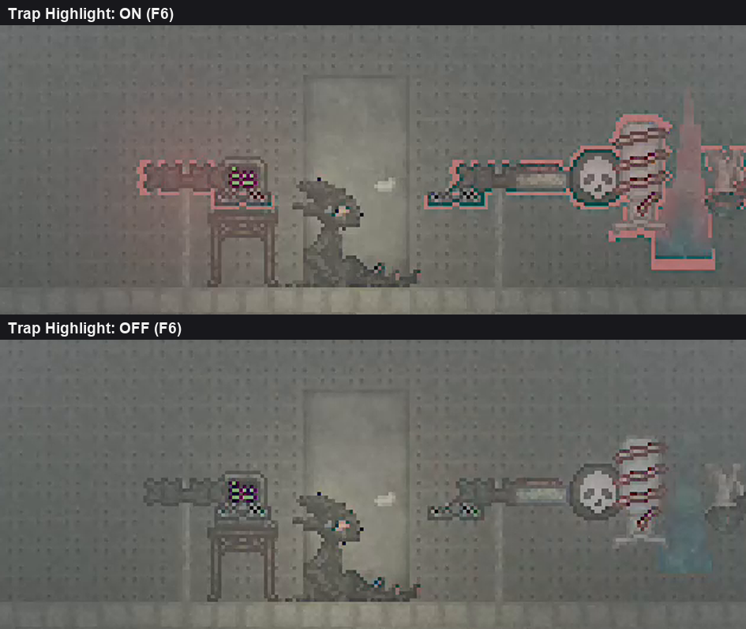
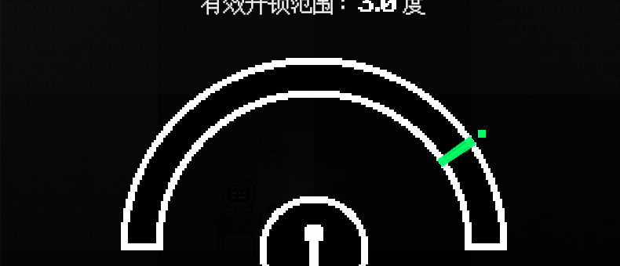

# Highlight

给《Casualties: Unknown》用的**危险陷阱 / 敌对生物高亮** BepInEx 5 插件（客户端视觉，纯本地，不改游戏文件、不同步、不影响联机判定）。

> 背景：截至 2026-11-16，Nexus（scavprototype）上没有专门做“世界内陷阱高亮/描边”的模组。
> 现有相关模组只有地图标记类（MistalCry's Map、Lazy Minimap、WorldMap）和 LiDAR 声呐类，
> 都需要打开地图或切换视觉模式；本插件直接在场景中给附近陷阱加描边和穿墙脉冲光晕。

## 功能

- 自动扫描玩家周围一定半径内的陷阱和敌对生物：陷阱**红色**、敌对生物**黄色**，描边 + 半透明脉冲色层。
- 可穿墙/穿黑暗显示（`Through Walls = true`），也可关掉只保留自然描边。
- 陷阱和敌对生物各有一份 ID 列表，默认列表见下；可在配置文件里随意增删，也可单独关闭敌对生物高亮。
- 开锁小游戏时，在正确角度位置画**绿色范围标记**（含容错范围），不用再盲试角度。
- `F6` 游戏内临时开关（可改键），切换时屏幕上方有短提示。
- 距离渐隐、呼吸脉冲、同时高亮数量上限，避免视觉污染和掉帧。
- 性能友好：每 0.25 秒一次 `Physics2D.OverlapCircle` 扫描，描边对象复用，不逐帧全场查找。
- 与 QoL Unknown、CUCoreLib、Casualties Together 共存；联机时只在本地显示。

## 效果预览



开锁辅助：正确角度与容错范围用绿色高亮。



*沙盒测试场景：上为开启高亮，下为按 F6 关闭后的原版画面（测试用生成陷阱，非正常刷新点）。*

## 安装

1. 确认游戏已安装 **BepInEx 5.4.x（x64, Mono）**。本机已具备：
   `D:\steam\steamapps\common\Casualties Unknown\BepInEx\`
2. 把 `Highlight.dll` 放到：
   ```
   ...\Casualties Unknown\BepInEx\plugins\Highlight\Highlight.dll
   ```
   （放在 `BepInEx\plugins\` 根目录也可以。）
3. 启动游戏。首次启动会生成配置：
   ```
   BepInEx\config\com.lead.highlight.cfg
   ```
4. 日志出现下面这行即加载成功：
   ```
   [Info   : Highlight] Highlight v1.2.0 loaded. ...
   ```

卸载：删除 `BepInEx\plugins\Highlight\` 文件夹即可。

## 配置（`com.lead.highlight.cfg`）

| 配置项 | 默认值 | 说明 |
| --- | --- | --- |
| `Enabled` | `true` | 总开关 |
| `Toggle Key` | `F6` | 游戏内临时开关 |
| `Radius` | `22` | 高亮半径（世界单位） |
| `Refresh Interval` | `0.25` | 扫描间隔（秒） |
| `Max Highlights` | `120` | 同时高亮上限 |
| `Trap Ids` | 见下 | 要识别的陷阱 ID，逗号分隔 |
| `Highlight Enemies` | `true` | 是否高亮敌对生物（黄色） |
| `Enemy Ids` | 见下 | 要识别的敌对生物 ID，逗号分隔 |
| `Color` | `#FF3B30` | 陷阱高亮颜色（红） |
| `Enemy Color` | `#FFD400` | 敌对生物高亮颜色（黄） |
| `Outline Alpha` | `0.90` | 描边不透明度 |
| `Overlay Alpha` | `0.35` | 覆盖色层不透明度（0 关闭） |
| `Outline Scale` | `1.15` | 描边相对贴图的放大比例 |
| `Pulse` | `true` | 呼吸闪烁 |
| `Pulse Speed` | `1.2` | 闪烁频率（次/秒） |
| `Through Walls` | `true` | 色层画在世界最上层，穿墙可见 |
| `Show Toggle Message` | `true` | 切换时显示提示 |
| `Verbose Log` | `false` | 输出每个新高亮陷阱（调试） |

### 开锁辅助

| 配置项 | 默认值 | 说明 |
| --- | --- | --- |
| `Show Lockpick Helper` | `true` | 开锁时显示绿色正确角度标记 |
| `Color` | `#00FF66` | 标记颜色 |
| `Width` | `6` | 标记线宽（像素，1–12） |
| `Inner Radius` | `195` | 标记内半径（小游戏 UI 单位） |
| `Outer Radius` | `247` | 标记外半径（小游戏 UI 单位） |

> 半径对应游戏开锁的有效距离 195–247；一般不用改，4K/缩放异常时可微调。

默认陷阱 ID：

```
beartrap, spikestabber, landmine, gunmine, sawblade,
ceilingturret, ceilingturretslim, turret, piston, pistonleft, pistonright,
skullcrusher, coil, soundcannon, drillpod, drillpodbroken,
geyser, lavageyser, spentfuel, radbarrel, icestalagmite,
mushroomdropper, barbedwirefence, grabberplant, grabbershroom,
spicevineceiling, spicevine
```

默认敌对生物 ID（11 种）：

```
shadecrawler, wallbiter, thornbackyoung, thornbackelder,
overgrowntick, cavetick, snowstrider, laserdrone,
crystalenemy, guard, bloodsuckerden
```

匹配时会自动忽略 `(Clone)`、实例编号后缀 ` (1)`、路径前缀和空格，大小写不敏感。
想把 `jumppad`、`fan`、`cactus`、`ceilingrye` 之类也点亮，直接加进陷阱列表即可；
游戏新增敌人时，把它的对象名加进 `Enemy Ids`。

## 原理（给想改代码的人）

- 游戏：Unity 2022.3.62f3，Mono 后端，BepInEx 5.4.23.6。
- 陷阱没有统一的 `Trap` 组件，世界生成时按 prefab 名 `Resources.Load("beartrap")` 等实例化，
  因此识别方式为：碰撞体 → 向上找 6 层父级 → 匹配对象名 / `BuildingEntity.id` /
  `BearTrap`、`FanTrap` 组件。敌对生物复用同一套扫描，只是用 `Enemy Ids` 列表匹配并改用黄色。
- 描边复用游戏自带的 `Special/ItemOutline` 材质（与地上物品白边同一套），
  色层使用 `Sprites/Default` 材质 + `SortingLayer` 最高层 + `sortingOrder 30000` 实现穿墙。
- 只在 `PlayerCamera.main.body != null && WorldGeneration.world.worldExists` 时工作，回主菜单自动清理。

## 从源码构建

需要 .NET SDK（本机为 10.0.401）：

```powershell
dotnet build src/Highlight/Highlight.csproj -c Release
```

`Highlight.csproj` 里的 `GameDir` 默认指向本机游戏目录，换机器时改这一项或传参：

```powershell
dotnet build src/Highlight/Highlight.csproj -c Release /p:GameDir="D:\steam\steamapps\common\Casualties Unknown"
```

或直接运行 `build.ps1`（编译 + 安装到游戏目录）。

## 已知限制

- 只识别有 2D 碰撞体的陷阱和生物；`grabberplant` / `grabbershroom`（只有 LineRenderer）不会被扫描到。
- 极少数多贴图陷阱只描边主贴图（取根节点或面积最大的子 SpriteRenderer）。
- 游戏更新若改动 `Assembly-CSharp` 的类名/字段，需要重新编译。
- 纯客户端效果，联机时其他玩家看不到；不影响陷阱判定与服务器逻辑。

## 版本

- 1.0.0 — 初版：物理扫描 + 描边/穿墙色层 + 热键 + 配置。
- 1.1.0 — 新增敌对生物高亮（黄色），复用陷阱扫描逻辑；新增 `Highlight Enemies` / `Enemy Ids` / `Enemy Color` 配置。
- 1.2.0 — 更名为 `Highlight`（DLL/GUID/配置文件名同步更新），新增 `HighlightKind` 分类，为后续更多高亮类别做准备。
- 1.3.0 — 开锁小游戏正确角度绿色高亮（含容错范围），新增 `5. Lockpick Helper` 配置。
