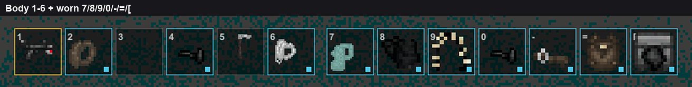

# Slot Hotkeys — 身体 6 槽位 + 穿戴容器快捷栏

《Casualties: Unknown / 未知伤亡》BepInEx 5 插件：

- 屏幕底部常驻 HUD：身体 **6 个槽位** + 最多 **7 个穿戴容器**（按键 `7/8/9/0/-/=/[`）；
- `1`–`6` 直接打开对应身体槽位的容器；穿戴容器按游戏穿戴列表顺序动态分配 `7/8/9/0/-/=/[`；
- 槽位受伤无法持物/背包时，HUD 对应格变红并显示 `!`，快捷键会拦截并提示，不会把工具丢出去；
- 支持把拖拽中的物品放到 HUD 格子里，右键 HUD 上的容器格也可以直接打开；
- 启用 mod 时把游戏加速键从 `1/2/3` 改到 `F1/F2/F3`，禁用 mod 后自动恢复。

- 版本：1.2.0
- 适用：Casualties: Unknown（Unity Mono / BepInEx 5.4.x x64）
- 纯客户端 UI/快捷键，不改物品、不改存档



*HUD：1–6 身体槽位，7–0 穿戴容器；金色边框 = 当前手，青色边框 = 容器，红色 = 受伤不可用。*

---

## 槽位对应

| 按键 | 槽位 | 游戏内名称 |
| --- | --- | --- |
| `1` | slots[0] | 主手（HandF） |
| `2` | slots[1] | 副手（HandB） |
| `3` | slots[2] | 嘴部（Head） |
| `4` | slots[3] | 上背部（UpTorso A） |
| `5` | slots[4] | 中背部（UpTorso B） |
| `6` | slots[5] | 下背部（DownTorso） |
| `7`/`8`/`9`/`0`/`-`/`=`/`[` | 穿戴容器 #1–#7 | 按 `GetAllWearables()` 顺序，只有带 `Container` 的穿戴物品才占用按键 |

> 穿戴容器的编号是动态的：穿戴/脱下、顺序变化后，`7/8/9/0/-/=/[` 会自动对应新的前 7 个穿戴容器。
>
> 游戏共有 7 个可装容器的穿戴槽位：back / thigh / thighback / outertorso / torsofront / bandolier / belt，所以最多同时 7 个。

---

## 使用

### 常驻 HUD

- 底部显示 6 个身体槽位 + 当前穿戴容器（最多 4 个）。
- 每格显示物品图标、快捷键数字：
  - 金色边框 = 当前使用的手；
  - 青色边框 + 右下角小点 = 容器；
  - **红色底 + 红色边框 + `!`** = 该槽位受伤/失去持物能力。
- 位置、大小、透明度、是否显示穿戴容器都可以配置。

### 槽位快捷键

- `1`–`6` 打开对应身体槽位的容器。
- `7`–`0`、`-`、`=`、`[` 打开对应穿戴容器的物品栏。
- 槽位没有容器时什么都不做（`Open Inventory When Empty = true` 可改为打开物品栏）。
- **受伤拦截**：槽位 `canPickUp == false` 时，快捷键不会移动/交换物品；工具切换会提示
  `Main hand injured - cannot hold tool` 或 `That slot is injured`，不会把工具丢到地上。

### 工具自动上手

- 按下的槽位是工具（`category = tool` 或 `tool` 标签）时自动换到主手：
  - 主手空 → 直接换；
  - 主手是普通物品 → 互换；
  - 主手是只能手持的物品 → 先放空副手；
  - 主手/副手都占且放不下 → `Main hand busy`，不动物品。

### 鼠标交互

- **拖拽放入**：从物品栏/地面拖动物品，松手在 HUD 的 1–6 格上即可装入/互换。
  - 目标槽位受伤、物品只能手持但目标是背部等情况会被拦截并提示。
- **右键打开**：右键 HUD 上带青色边框的格子（身体槽位或穿戴容器），直接打开该容器。

### 加速键重映射

- 启用 mod：`F1` 正常、`F2` 加速、`F3` 超快。
- 禁用 mod：恢复原版 `1/2/3`；`settings.json` 中始终写入原始键位，不会留下 F1/F2/F3。

---

## 配置

配置文件：`BepInEx\config\com.lead.slothotkeys.cfg`，修改后重启生效。

### 常规

| 配置项 | 默认值 | 说明 |
| --- | --- | --- |
| `Enabled` | `true` | 总开关 |
| `Slot 1 Key ...` ~ `Slot 6 Key ...` | `Alpha1`–`Alpha6` | 身体 6 槽位快捷键 |
| `Slot 7 Key (Worn Container 1)` | `Alpha7` | 穿戴容器 #1 |
| `Slot 8 Key (Worn Container 2)` | `Alpha8` | 穿戴容器 #2 |
| `Slot 9 Key (Worn Container 3)` | `Alpha9` | 穿戴容器 #3 |
| `Slot 0 Key (Worn Container 4)` | `Alpha0` | 穿戴容器 #4 |
| `Slot Minus Key (Worn Container 5)` | `Minus` | 穿戴容器 #5 |
| `Slot Plus Key (Worn Container 6)` | `Equals` | 穿戴容器 #6 |
| `Slot Bracket Key (Worn Container 7)` | `LeftBracket` | 穿戴容器 #7 |

### 行为

| 配置项 | 默认值 | 说明 |
| --- | --- | --- |
| `Open Inventory When Empty` | `false` | 槽位没有容器时是否打开物品栏 |
| `Tool To Main Hand` | `true` | 工具类道具自动换到主手 |
| `Remap Speed Keys` | `true` | 加速键改为 F1/F2/F3（禁用后恢复） |
| `Speed 1 Key` | `F1` | 正常速度 |
| `Speed 2 Key` | `F2` | 加速 |
| `Speed 3 Key` | `F3` | 超快 |
| `Suppress Speed Keys In Inventory` | `true` | 仅关闭重映射时生效：物品栏内屏蔽 1/2/3 加速 |

### HUD

| 配置项 | 默认值 | 说明 |
| --- | --- | --- |
| `Show Slot HUD` | `true` | 显示 HUD |
| `Show Worn Containers` | `true` | 显示穿戴容器格（最多 7 个） |
| `Position` | `BottomCenter` | `BottomCenter` / `TopCenter` / `TopLeft` |
| `Scale` / `Opacity` | `1.0` / `0.9` | 缩放 / 不透明度 |
| `Offset X` / `Offset Y` | `0` / `0` | 像素偏移 |
| `Highlight Active Hand` | `true` | 金色边框标当前手 |
| `Hide When Inventory Open` | `false` | 打开物品栏时隐藏 HUD |
| `Show Hotkey Numbers` | `true` | 显示数字 |

### 其他

| 配置项 | 默认值 | 说明 |
| --- | --- | --- |
| `Show Messages` | `true` | 操作提示 |
| `Verbose Log` | `false` | 调试日志 |

---

## 安装

1. 安装 BepInEx 5.4.x（x64, Mono）。
2. 把 `SlotHotkeys.dll` 放到：
   ```
   ...\Casualties Unknown\BepInEx\plugins\SlotHotkeys\SlotHotkeys.dll
   ```
3. 启动游戏，日志出现 `Slot Hotkeys v1.1.0 loaded` 即成功。
4. 首次启动生成 `BepInEx\config\com.lead.slothotkeys.cfg`。

---

## 注意事项

- 只读取游戏自身的槽位/穿戴/容器数据，不改变物品位置、重量、容器逻辑。
- 穿戴容器最多显示/绑定 7 个，对应游戏 7 个可装容器的穿戴槽位。
- HUD 是纯客户端 IMGUI 绘制，联机不影响其他玩家。
- 与 **Cu-Hotbar** 的数字键会冲突，建议改键或只保留一个。
- `F1`–`F3` 如与其他 mod 冲突，可改 `Speed 1/2/3 Key` 或关闭 `Remap Speed Keys`。
- 卸载：删除 `BepInEx\plugins\SlotHotkeys\` 和 `com.lead.slothotkeys.cfg`，加速键会自动恢复。
